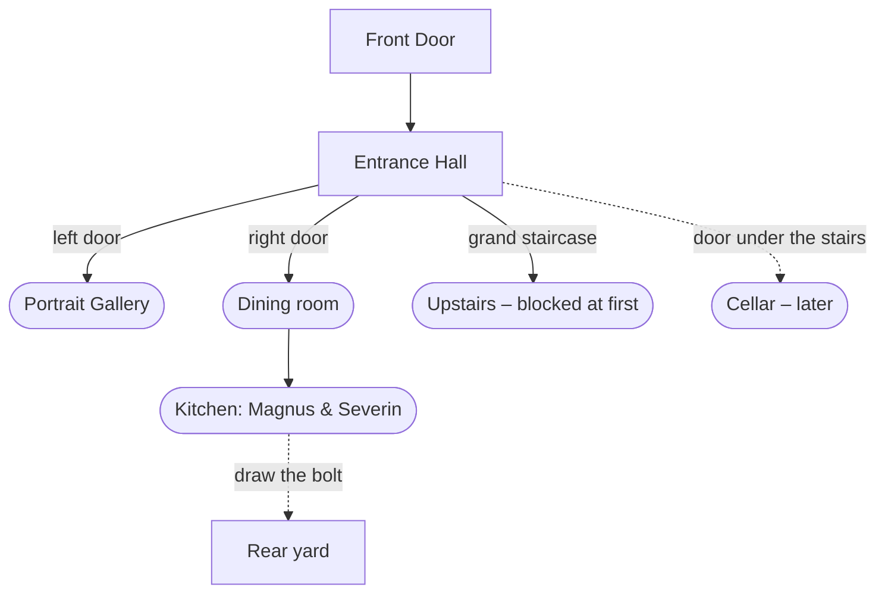

# The Entrance Hall – design draft

The first room inside the Mansion, and the hub for the house: the same job the
Courtyard does outside. **This is a draft for discussion.** Anything marked
*(suggestion)* is open.

**Built so far:** the background (`entrance_hall.png`) and the scene with its
hotspots – staircase, landing, window, chandelier, family portrait (the
Worn Photograph reacts to it), the left, right and low doors, grandfather
clock, covered mirror, candles, coat stand and the cat. The doors and the
stairs answer "Not yet" until the rooms beyond exist. Quazimodo's greeting
and the puzzles below are not built.

> Outside taught the player the verbs. Inside, the house starts to **notice
> them** – quietly, without explaining itself.

## What the game has already promised

These are already in the dialogue, so the house should honour them:

| Who | Where they live (suggestion) | Already said about them |
|---|---|---|
| **Quazimodo** | the hall – he keeps the door | *"The house has admitted far worse people for considerably poorer reasons."* Hautain: *"The crooked coat-rack from the house."* |
| **Magnus & Severin** | the kitchen | *"The enormous kitchen despot and the thin one who looks personally offended by soup."* Magnus owes the Treasury three snails. |
| **Pip** | the library | *"The deceased librarian. Proper manners. Terrible military potential."* |
| **Velvet** | high in the hall, the stairwell | *"The eight-legged Department of Unnecessary Infrastructure."* (A spider. She means well.) |
| **Sola** | wherever she likes | *"The furry assassin."* (A cat.) |
| **Gréll** | the glasshouse? | *"That creature is forbidden from Crown territory."* No joke – on purpose. |

Hautain's warning also sets the tone: *"Do not allow the place to convince you
that it owns you."*

## The room

A tall, candlelit Victorian hall. Every candle is lit, like the lanterns
outside – someone keeps them lit.



### Hotspots (suggestion)

| Hotspot | LOOK | ACT / TALK / ITEM |
|---|---|---|
| **Front Door** | Rain against the glass. | Back outside. |
| **Grand Staircase** | Sweeps up into the dark. | Upstairs is blocked at first (see puzzle 2). |
| **Chandelier** | Every candle lit. Something has strung fine silver lines between its arms. | Velvet's work – a first glimpse of her. |
| **Covered Mirror** | A tall mirror, a dust sheet over it. | ACT: you lift a corner of the sheet… and decide to leave it. *Never explained* (it fits the rain-barrel reflection and Ebria's refusal of the mirror). |
| **Grandfather Clock** | Stopped at a quarter past something. | It ticks once when you turn away. *(suggestion – small, unexplained)* |
| **Family Portrait** | The family that lived here. The paint has flaked away from one face – the same place the photograph decayed. | Use the **Worn Photograph** on it: a memory (journal entry). *Who* is still deliberately undecided. |
| **Coat Stand** | Crooked. Hautain's "coat-rack" joke pays off: TALK – *"Good evening, Quazimodo."* It is a coat stand. | |
| **Sola** (on the stairs) | A black cat *(colour: suggestion)*, watching you. | TALK: she leaves. She is back on the stairs next time. |
| **Left door / Right door** | Portrait Gallery (not locked) / dining room. | Move on. |
| **Small door under the stairs** | Cellar. | Locked from below? Ties to the knock. *(later – no key)* |

### How Quazimodo greets you (suggestion – from how you got in)

The flags already exist, so the hall can remember:

- **Paid** (`PaidQuazimodo`): businesslike – *"Your receipt is the door closing behind you."*
- **Polite** (`QuazimodoAdmittedPlayer`): warm, in his way. He offers to take your coat.
- **Party hat** (`QuazimodoPartyHat`): he is still wearing it. He doesn't mention it.
- **Forced** (`ForcedEntry`, `DefeatedQuazimodo`): he keeps his distance, and the house is a little colder – a candle or two goes out as you pass. *(suggestion)*

## First puzzles inside (suggestions)

1. **The kitchen shortcut.** In the kitchen, draw the bolt on the service door
   → the rear yard's kitchen door opens (`KitchenDoorUnlocked`). Pays off the
   bolted door outside. Magnus and Severin are arguing about soup; the bolt is
   behind them – get past the argument (TALK, or bring something for Magnus:
   *three snails* for the Treasury?).
2. **Upstairs.** Velvet has strung her "infrastructure" across the landing.
   It isn't a lock: she will take it down if you ask the right way, or if you
   bring her something she can use (the **Ball of String**? the **Rope**?).
   Stats as a shortcut: a Wits test to notice which strand to lift.
3. **The library and the Paper.** Pip's library is the natural home of the
   **Paper** – which closes the gravestone rubbing loop outside and makes the
   player go back out (interlock). Pip is polite, dead, and very particular
   about borrowing.

## Still to decide

- Which of the puzzles above to build first (suggestion: the kitchen shortcut).
- Where the **Red Rose** goes – Pip? the portrait? the gravestone (*"ONCE FOR THE HEART"*)?
- What the **Rope** is for – Velvet, or the cellar later?
- Is Gréll in the glasshouse, and how does the house connect to it?

---

## Art prompt for the background (ChatGPT)

Attach **Front_door.png** (or courtyard.png) as a style reference, with the
same note as for the tool shed:

```
The attached image is a scene from the same game. Use it ONLY as a reference for the art style, colour palette, lighting and level of detail. Do NOT copy its composition, and do NOT copy any dark blurred bands at its top or bottom edges.

Create a 1536x1024 landscape digital painting for a gothic horror point-and-click adventure game: the ENTRANCE HALL inside an old Victorian mansion, at night, seen from just inside the front door.

Composition (everything important between roughly 20% and 80% of the image height):
- A grand wooden staircase in the centre, rising and turning into darkness. A black cat sits on one of the lower steps, small in the picture.
- A large chandelier hanging above the hall, every candle lit, with a few very fine silver threads strung between its arms (like spider silk catching the light - subtle).
- On the left wall: a tall panelled door (to the library), and a large old family portrait in a gilded frame showing four or five people in Victorian dress; one face has flaked away to bare canvas.
- On the right wall: a tall panelled door (to the dining room), a grandfather clock, and a tall mirror completely covered by a grey dust sheet.
- Beside the front door area on the far left: a crooked wooden coat stand.
- Under the staircase: a small, low door.
- Worn chequered marble floor, a faded runner rug, dark wood panelling, candle sconces on the walls, everything lit. Rain visible streaming down a tall window above the landing.

Mood and style (match the reference): highly detailed, painterly, dark-fantasy realism. Warm amber candlelight against deep shadows, cold blue moonlight from the window. Grand but neglected: dust, cobwebs in the high corners, nothing broken. Quiet, watchful and slightly uneasy, not frightening.

Composition rules:
- Full-bleed image. No borders, letterboxing, frames, text, labels or watermarks.
- Keep the top-left corner fairly plain and dark (a game button sits there).
- The top 18% and bottom 18% of the image will be cropped in the game. Use them only for ceiling and floor, with nothing important there.
- No people. The only creature is the small black cat on the stairs.
```

Afterwards (same chat), a version for later in the game:

```
Edit this exact image: remove ONLY the black cat from the stairs, filling the step to match. Change nothing else.
```
