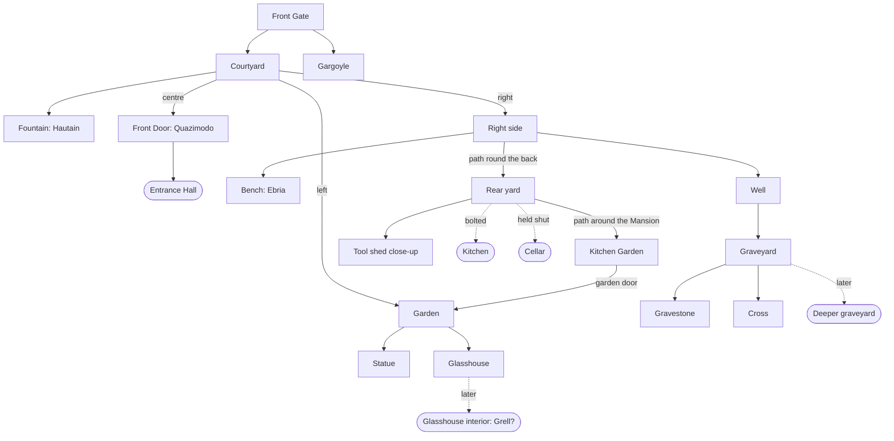

# The Mansion – Outside: Puzzle Design

The exterior is the game's hub and its tutorial. It shouldn't get much bigger;
it should **interlock**: a clue in one place opens something in another,
characters talk about each other, and doors opened from inside become shortcuts.

> *"This isn't a collection of rooms. Everyone actually lives here."*

## Design rules

- **Stats create shortcuts. Items provide reliable solutions.** A failed roll
  never blocks progress – there is always another way (e.g. Wits *or* a rubbing).
- **No more keys for their own sake.** Rewards should mean something: a
  memory, a reaction, a new route.
- **Don't tell the player where an item goes.** Classic inventory design.
- **Mementos** are objects that stir memories the player doesn't know they
  have. The first one belongs to the player's own mystery, not an NPC's quest.
- Characters reference each other, and **their accounts don't agree**.
- Comedy once; then the world remembers (the rose bush hurts *once*).
- Every real clue gets a **journal entry** (`Data/Journal.cs`), so the player
  never has to write it down themselves.

## Outdoor map

Rounded boxes don't exist yet. The outside is one loop:
Courtyard → Right side → Rear yard → Kitchen Garden → Garden → Courtyard.

## The puzzles

### 0. Getting in: the Front Door and the people around it ✅ built
The first "gate". Every route works; each one leaves a mark the world remembers.
- **Quazimodo** opens the door for: **payment** (Royal Gold Coin, the
  fountain's Gold Coins or the trunk's Loose Change), **good manners**
  (talking your way in), or **force** (threats or a fight – `ForcedEntry`).
  The **Party Hat** from the trunk softens him.
- **King Hautain** (fountain): grab his gold (`StoleCoins` – the Royal grudge
  stays even if you pay Quazimodo with it), recognise his sovereignty for a
  **Royal Gold Coin**, or fight him.
- **The Gargoyle**: notice what others overlook → **Gargoyle's Blessing**
  (Luck +1). Second visit: *"You don't cast rain properly."*
- **Ebria**: the **Corkscrew** from the trunk – *"Now I have to like you a
  little."* A small relationship beat, no reward.

### 1. The Graveyard Secret → first Memento ✅ built
1. **Gravestone inscription** – LOOK: worn smooth. ACT: **Wits test** (retry
   allowed; failure says *"There must be another way to recover the
   inscription."*). Or **Charcoal + Paper** (use either while carrying both):
   a rubbing, always works. Reveals:
   **THRICE FOR HEAVEN · ONCE FOR THE HEART · NEVER FOR THE HAND THAT LET GO**
2. **The cross** – three spirals at the centre (up, left, right). Before the
   clue: *"You push the carving. Nothing."* After it, each turns a quarter on
   ACT and says where it points. Solution: **up ×3, left ×1, right ×0**.
3. **The plinth opens** → **Worn Photograph** (Memento): the Mansion as it
   was; a small group; one face decayed away; on the back *"You said you'd
   come back."* Taking it: *the rain stops… you remember sunlight.*
   Who the people are is **deliberately undecided** – it should fit the ending.

### 2. The Well → Cracked Hand Mirror ✅ built
Replaces the Old Key. Ball of String (always) or bucket (Luck, retry).
**Show it to Ebria**: *"No." / "It's a mirror." / "I can see that."*, then
*"Put that away."*, then *Ebria will not look at it.* Never taken – it isn't
hers (and not her sister's either). Pays off much later.

### 3. The Rose Bush → Red Rose ✅ built
First ACT: −2 Health, once. After: *"You've already conducted this
experiment."* At ≤2 Health: *"Something resembling common sense finally
intervenes."* (A rose bush must never kill you.) **Garden Shears** → **Red
Rose**. The shears are in the **tool shed** (rear yard); once a rose is cut,
the background shows it gone. Where the rose goes is not told – **still to
be decided**.

### 4. The Faceless Knight → Stone Sword ✅ built
Words on the blade: **HE WHO WOULD TAKE THE BLADE MUST FIRST SURRENDER HIS OWN.**
Holding a weapon: the stone fingers tighten. Put it away (click **WEAPON** in
the stats panel) → GRIND → the sword comes free (+2). The solution is
understanding, not an item. The statue's picture changes once the sword is
taken.

### 5. Characters who know each other ✅ built
- **Hautain** on Ebria: *"THE BENCH-DWELLING MENACE."* She *"DESCENDED FROM THE
  HEAVENS upon my Eastern Provinces."* – Ebria: *"I fell in the pond."*
- **The Gargoyle** (second visit): *"You don't cast rain properly." … "Nothing."*
  The first hint that something is wrong with the player.

### 6. The Rear Yard and Kitchen Garden ✅ built
- **Rear yard:** kitchen door (bolted from inside – later a shortcut when
  the bolt is drawn from the kitchen), cellar doors (one knock, never
  explained), pump + trough, drain, The Sock (not an item, not a puzzle),
  tool shed (Rope on the outside wall; inside, in its own close-up, the
  Garden Shears and Charcoal on the workbench, taken in any order, and a
  locked cabinet that stays locked – only more tins).
- **Kitchen Garden:** a tended walled garden; the garden door leads back to
  the Garden. Scenery only, with a few hooks (below).

### 7. Open threads – planted, deliberately unexplained
Don't explain these yet; each should pay off (or be noticed) later.
| Where | Hook |
|---|---|
| Gargoyle | *"You don't cast rain properly."* – something is wrong with the player |
| Photograph | The rain stops when you take it; *"You said you'd come back."* |
| Cellar doors | A single knock from underneath |
| Glasshouse doors | They rattle *"as if something inside pushed back"*; every candle lit |
| Rain barrel (Kitchen Garden) | Your reflection takes a moment longer than it should |
| Vegetable beds | Tended, healthy out of season; a leek *"rooted rather more firmly than leeks ought to be"* |
| Drain (Rear yard) | Tiny pale fragments. *"Probably kitchen scraps."* |
| Cracked Hand Mirror | Ebria won't look at it; it isn't hers (or her sister's) |
| Lanterns everywhere | Someone keeps them lit |

### 8. Still to build
| What | Needs |
|---|---|
| **Paper** – where is it found? (Charcoal: tool shed) | Decision |
| **Red Rose** – who or what is it for? | Decision |
| **Rope** – what is it for? | Decision |
| **Glasshouse interior** (Grell's territory?) | Art + design |
| **Entrance Hall** – where the Front Door leads | Art + design |
| Kitchen and cellar (from inside the Mansion) | Design |

## What the exterior teaches

| Location | Teaches |
|---|---|
| Front Gate | LOOK / TALK |
| Fountain | Consequences; characters react |
| Courtyard | Navigation (ACT moves on) |
| Garden | Investigation |
| Statue | State / equipment puzzle |
| Glasshouse | Locked places to come back to |
| Right side | ACT reveals hidden things (the bench) |
| Bench | Character discovery |
| Rose bush | Health consequences – once |
| Well | ITEM use |
| Graveyard | Multi-scene puzzle |
| Rear yard | Shortcuts (doors opened later from inside) |
| Kitchen Garden | The world loops; small unexplained details |
