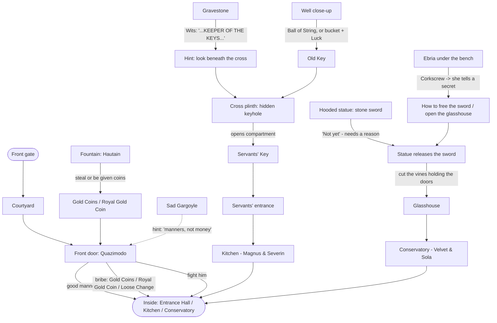

# The Mansion – Puzzle Chart (DRAFT – for discussion)

A proposal built from what's already in the game. Nothing here is built yet;
change anything. Questions for you are at the bottom.

## Act 1 goal: get inside the Mansion

Three routes in, each suited to a different kind of player. At least one
must always be possible; doing more gives extra rewards later.

## The routes

| Route | Style | Needs | Lands you in | Built? |
|---|---|---|---|---|
| A. Front door | Social | Manners, a bribe, or a fight | Entrance Hall | Yes – only the Entrance Hall scene is missing |
| B. Servants' entrance | Exploration / clues | Old Key + gravestone clue → Servants' Key | Kitchen | Hooks exist (key, inscription, hollow plinth, locked door) |
| C. Glasshouse | Riddle / characters | Ebria's secret → statue's sword | Conservatory | Hooks exist (statue "not yet", rattling doors, Ebria) |

## What this gives the existing hooks

| Hook | Becomes |
|---|---|
| Old Key (well) | Opens the hidden keyhole in the cross plinth |
| "…KEEPER OF THE KEYS…" (gravestone, Wits) | The clue that the plinth hides something |
| Hollow plinth (cross close-up) | Holds the Servants' Key |
| Locked servants' entrance | Opens with the Servants' Key |
| Stone sword ("Not yet, anyway") | Freed once you learn how (route C) |
| Glasshouse doors that rattle back | Held shut by vines – and something inside |
| Ebria + Corkscrew | Trades a secret for the corkscrew |
| Gargoyle's Blessing (Luck +1) | Helps the bucket Luck test at the well |
| Path to the back of the house | Act 2, or a fourth route later |

## Questions for you
1. Is **"get inside"** the right goal for Act 1?
2. Do you like **three routes** in, or should there be one main route with
   optional extras?
3. **The Old Key's story** – Ebria no longer mentions it. Who dropped it in the
   well? (The "Keeper of the Keys" on the gravestone?)
4. **What's behind the glasshouse doors?** (Hautain called Velvet "the eight-legged
   Department of Unnecessary Infrastructure" – a giant spider fits "pushed back".)
5. **What does Ebria trade for the Corkscrew** – is she the one who knows the
   statue's secret?
6. Should the routes **change what happens inside** (e.g. sneaking in via the
   kitchen means Quazimodo doesn't know you're there)?
