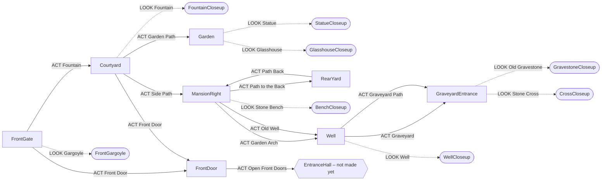

# The Mansion – Scenes and Close-ups

Generated from `Data/Scenes.cs` by `Tools/list_scenes.py` – re-run it after
changing scenes. **LOOK** opens close-ups, **ACT** moves on, the Return arrow
works with any verb.

## Map

Rounded boxes are close-ups. Dotted arrows = LOOK, solid = ACT.

## Contents

- [FrontGate](#frontgate) – Scene
- [FountainCloseup](#fountaincloseup) – Close-up
- [Courtyard](#courtyard) – Scene
- [Garden](#garden) – Scene
- [StatueCloseup](#statuecloseup) – Close-up
- [GlasshouseCloseup](#glasshousecloseup) – Close-up
- [MansionRight](#mansionright) – Scene
- [RearYard](#rearyard) – Scene
- [BenchCloseup](#benchcloseup) – Close-up
- [Well](#well) – Scene
- [GraveyardEntrance](#graveyardentrance) – Scene
- [WellCloseup](#wellcloseup) – Close-up
- [CrossCloseup](#crosscloseup) – Close-up
- [GravestoneCloseup](#gravestonecloseup) – Close-up
- [FrontGargoyle](#frontgargoyle) – Close-up
- [FrontDoor](#frontdoor) – Scene

## FrontGate

**Scene** · `Assets/Backgrounds/Mansion/frontgate.png`

> You are standing before an old and creepy mansion.

- **Reached from:** Courtyard – Return arrow; FrontGargoyle – Return arrow
- **Exits:** Courtyard (ACT *Fountain*); FrontDoor (ACT *Front Door*)
- **Close-ups:** FrontGargoyle (LOOK *Gargoyle*)

| Object | LOOK | ACT | TALK | Items |
|---|---|---|---|---|
| Fountain | An ancient stone fountain stands in the courtyard beyond the gates. | → **Courtyard** | – | – |
| Front Door | The enormous wooden door looks like it has not opened in years. | → **FrontDoor** | – | – |
| Gargoyle | → **FrontGargoyle** | – | – | – |

## FountainCloseup

**Close-up** · `Assets/Backgrounds/Mansion/fountain_closeup.png`

> Lily pads float on the dark water. Beneath the surface, a small pile of gold coins glitters.

- **Reached from:** Courtyard – LOOK on *Fountain*
- **Return arrow →** Courtyard
- **Characters:** King Hautain (ACT *Gold Coins*, conversation `HautainCoins`)

| Object | LOOK | ACT | TALK | Items |
|---|---|---|---|---|
| Gold Coins | Several old gold coins rest at the bottom of the fountain. | conversation `HautainCoins` | – | **Gold Coins**: You drop the stolen coins back into the fountain. From somewhere among the lily pads comes a grudging "Hmph." (Royal Grudge lifted) (item used up) |

## Courtyard

**Scene** · `Assets/Backgrounds/Mansion/courtyard.png`

> Rain-slick cobblestones glitter in the lantern light. A tiered fountain splashes beside the steps up to the front door.

- **Reached from:** FrontGate – ACT on *Fountain*; FountainCloseup – Return arrow; Garden – Return arrow; MansionRight – Return arrow; FrontDoor – Return arrow
- **Exits:** FrontDoor (ACT *Front Door*); Garden (ACT *Garden Path*); MansionRight (ACT *Side Path*)
- **Close-ups:** FountainCloseup (LOOK *Fountain*)
- **Return arrow →** FrontGate

| Object | LOOK | ACT | TALK | Items |
|---|---|---|---|---|
| Fountain | → **FountainCloseup** | – | – | – |
| Front Door | Wide stone steps lead up to the mansion's great carved doors. | → **FrontDoor** | – | – |
| Garden Path | A path runs behind the fountain, along the balustrade, around the left wing of the mansion. | → **Garden** | – | – |
| Side Path | A cracked, winding path disappears into the overgrown dark beside the mansion. | → **MansionRight** | – | – |

## Garden

**Scene** · `Assets/Backgrounds/Mansion/garden.png`

> The path ends in an overgrown garden. Mist curls around a hooded statue, and beyond it a great glasshouse glows in the dark.

- **Reached from:** Courtyard – ACT on *Garden Path*; StatueCloseup – Return arrow; GlasshouseCloseup – Return arrow
- **Close-ups:** GlasshouseCloseup (LOOK *Glasshouse*); StatueCloseup (LOOK *Statue*)
- **Return arrow →** Courtyard

| Object | LOOK | ACT | TALK | Items |
|---|---|---|---|---|
| Glasshouse | → **GlasshouseCloseup** | – | – | – |
| Mansion | Ivy smothers the mansion's left wing. Warm light glows in the tall windows. | – | – | – |
| Statue | → **StatueCloseup** | – | – | – |

## StatueCloseup

**Close-up** · `Assets/Backgrounds/Mansion/statue_closeup.png`

> The statue towers over you: a hooded figure in a ragged stone robe, its hands resting on the hilt of a great sword.

- **Picture changes** to `Assets/Backgrounds/Mansion/statue_closeup_nosword.png` when **TookStoneSword**
- **Reached from:** Garden – LOOK on *Statue*
- **Return arrow →** Garden

| Object | LOOK | ACT | TALK | Items |
|---|---|---|---|---|
| Glasshouse (2 places) | Through the mist, candles glow behind the glasshouse's tall panes. | – | – | – |
| Statue | Ivy creeps up the ragged stone robe. Under the hood there is only darkness. | – | The statue says nothing. Statues usually don't. Usually. | – |
| Hood | You peer into the hood. There is no face carved there at all - just shadow. | – | – | – |
| Stone Sword *(only when not TookStoneSword)* | A great stone sword, its point resting on the plinth. The hilt is worn smooth, as if many hands have gripped it. Words are cut along the blade: HE WHO WOULD TAKE THE BLADE MUST FIRST SURRENDER HIS OWN. | (depends on a dice roll / the story - see Data/Scenes.cs)  [gives Stone Sword]  [sets TookStoneSword] | – | – |
| Empty Hands *(only when TookStoneSword)* | The statue's stone hands are folded around nothing now. Under the hood, the darkness seems... satisfied. | – | – | – |

## GlasshouseCloseup

**Close-up** · `Assets/Backgrounds/Mansion/glasshouse_closeup.png`

> The glasshouse rises before you, all iron lace and misted glass. Inside, hundreds of candles burn among tall palms.

- **Reached from:** Garden – LOOK on *Glasshouse*
- **Return arrow →** Garden

| Object | LOOK | ACT | TALK | Items |
|---|---|---|---|---|
| Glass Dome | Rain beads on the great glass dome. Ivy has crept almost to the top. | – | – | – |
| Windows (2 places) | Through the misted panes you can make out palms, ferns - and candles, far too many candles. | – | – | – |
| Lantern (2 places) | An iron lantern on a stone pillar, lighting the steps. | – | – | – |
| Chandelier | A chandelier blazes just inside, above the doors. Someone lit every candle. | – | – | – |
| Glasshouse Doors | Tall glass doors with brass handles. The air seeping out is warm and smells of earth and wax. | You push the doors. They don't open - yet they rattle, as if something inside pushed back. | – | – |

## MansionRight

**Scene** · `Assets/Backgrounds/Mansion/mansion_right.png`

> A wet stone path curves along the mansion's right wing, past a servants' entrance, to an archway in the garden wall. Beyond it, steps climb to an old well.

- **Reached from:** Courtyard – ACT on *Side Path*; RearYard – ACT on *Path Back*; RearYard – Return arrow; BenchCloseup – Return arrow; Well – Return arrow
- **Exits:** Well (ACT *Garden Arch*); RearYard (ACT *Path to the Back*); Well (ACT *Old Well*)
- **Close-ups:** BenchCloseup (LOOK *Stone Bench*)
- **Return arrow →** Courtyard

| Object | LOOK | ACT | TALK | Items |
|---|---|---|---|---|
| Lantern | An iron lantern on a stone post. Its flame burns steadily, despite the rain. | – | – | – |
| Windows | Candles burn behind the tall windows, but nothing moves inside. | – | – | – |
| Servants' Entrance | A smaller door at the top of a few worn steps - the servants' entrance. Lanterns burn on either side. | You knock on the door, but there is no response. Jiggling the handle reveals a surprise! ...It's locked! | – | – |
| Garden Arch | An ivy-covered archway in the garden wall. Steps beyond it climb towards the well. | → **Well** | – | – |
| Path to the Back | The cobbled path curves away along the garden wall, around to the back of the mansion. | → **RearYard** | – | – |
| Old Well | A small roofed well stands at the top of the hill. | → **Well** | – | – |
| Rose Bush *(only when not GotRedRose)* | A great tangle of blood-red roses, impossibly in bloom this late in the year. | (depends on a dice roll / the story - see Data/Scenes.cs) | – | **Garden Shears**: Snip. Much better. You cut one perfect dark-red rose. |
| Rose Bush *(only when GotRedRose)* | A great tangle of blood-red roses. There's a small gap where you cut one. | (depends on a dice roll / the story - see Data/Scenes.cs) | – | **Garden Shears**: Snip. Much better. You cut one perfect dark-red rose. **Garden Shears**: You already have a rose. Leave the rest of them be. |
| Stone Bench *(only when not HeardBenchNoise)* | A mossy stone bench beside the roses. | You sit down on the cold, damp stone... and from somewhere underneath you comes a faint hiccup. Then a tiny, slurred giggle.  [sets HeardBenchNoise] | – | – |
| Stone Bench *(only when HeardBenchNoise)* | → **BenchCloseup** | You sit down again. The hiccuping stops. Then: "...I can hear you breathing." | – | – |

## RearYard

**Scene** · `Assets/Backgrounds/Mansion/rear_yard.png`

> A rain-soaked service yard behind the Mansion. Ordinary work seems to have simply stopped here.

- **Reached from:** MansionRight – ACT on *Path to the Back*
- **Exits:** MansionRight (ACT *Path Back*)
- **Return arrow →** MansionRight

| Object | LOOK | ACT | TALK | Items |
|---|---|---|---|---|
| Path Back | The wet path continues around the side of the Mansion. | → **MansionRight** | – | – |
| Path Around Mansion | The narrow service path continues around the Mansion. Something glass-roofed is visible through the trees. | – | – | – |
| Ivy | Ivy has claimed most of the rear wall. The Mansion rises almost vertically above the little service yard. | – | – | – |
| Windows (2 places) | Narrow service windows overlook the yard. A few glow warmly despite the abandoned courtyard below. | – | – | – |
| Lantern | A lantern burns beside the service door. Someone keeps these lit. | – | – | – |
| Kitchen Door | A heavy service door leads into the Mansion, with a small barred window and heavy iron hardware. Generations of boots have worn the edges of the stone steps smooth. | The door shifts half an inch, then stops against something solid. Bolted from the other side. | – | – |
| Cellar Doors *(only when not TriedCellarDoor)* | A pair of heavy cellar doors descend beneath the Mansion. The left door doesn't quite sit flush with its frame. | You pull the iron ring. The door rises an inch. Stops. Something underneath is holding it shut. ... A single quiet sound comes from underneath. Knock.  [sets TriedCellarDoor] | – | – |
| Cellar Doors *(only when TriedCellarDoor)* | A pair of heavy cellar doors descend beneath the Mansion. The left door doesn't quite sit flush with its frame. | Still blocked. Whatever is beneath it isn't moving. | – | – |
| Clothesline | An old washing line stretches across the yard. Almost everything that once hung from it is gone. | – | – | – |
| Sock | A solitary black sock hangs from the washing line. | (depends on a dice roll / the story - see Data/Scenes.cs)  [sets TouchedSock] | – | – |
| Hand Pump | An old iron hand pump feeds the stone washing trough. The metal is rusted, but the mechanism appears intact. | (depends on a dice roll / the story - see Data/Scenes.cs)  [sets TroughFilled] | – | – |
| Stone Trough *(only when not TroughFilled)* | A deep stone trough stained by generations of water. | Dry, apart from rain collecting in the bottom. | – | – |
| Stone Trough *(only when TroughFilled)* | Cold rainwater and pump water fill the old stone trough. | The water is painfully cold. | – | – |
| Drain | Rainwater disappears through an iron grate beneath the Mansion. A few tiny pale fragments have collected against the grate. Probably kitchen scraps. | The grate is firmly set into the cobbles. | – | – |
| Tool Shed | A small gardening shed leans against the wall, its roof thick with moss. The tools outside have been left exactly where someone last used them. Apparently nobody came back for them. | – | – | – |
| Shed Door *(only when not OpenedToolShed)* | A small gardening shed leans against the wall, its roof thick with moss. | The shed door scrapes open. Inside: shelves of rusted tins, a little workbench, a pair of garden shears and a few sticks of charcoal.  [sets OpenedToolShed] | – | – |
| Workbench *(only when OpenedToolShed and not GotGardenShears)* | A sturdy pair of pruning shears lies on the workbench - rusty, but still serviceable. Beside them, a few sticks of charcoal. | You take the garden shears.  [gives Garden Shears]  [sets GotGardenShears] | – | – |
| Workbench *(only when GotGardenShears and not GotCharcoal)* | A few sticks of charcoal lie on the workbench. Messy, but still usable. | You take the charcoal, and most of its dust with it.  [gives Charcoal]  [sets GotCharcoal] | – | – |
| Workbench *(only when GotGardenShears and GotCharcoal)* | Rusted tins, broken pots and a locked cabinet. Nothing else worth taking. | There's nothing else in the shed worth carrying around. | – | – |
| Rope *(only when not GotRope)* | A coil of old rope hangs on the shed wall. Damp, but stronger than it looks. | You lift the coil of rope off its hook.  [gives Rope]  [sets GotRope] | – | – |
| Shovel | A heavy garden shovel hangs from a hook rusted solid around its handle. | It isn't coming free without taking half the shed with it. | – | – |
| Pitchfork | An old pitchfork. Several tines have rusted away. | – | – | – |
| Rake | A rake with half its teeth missing. | – | – | – |

## BenchCloseup

**Close-up** · `Assets/Backgrounds/Mansion/bench_closeup.png`

> A carved stone bench stands against the wall, half swallowed by an enormous rose bush. Something tiny hiccups underneath it.

- **In the scene:** `Assets/Characters/Ebria_UnderBench.png`
- **Reached from:** MansionRight – LOOK on *Stone Bench*
- **Return arrow →** MansionRight
- **Characters:** Ebria (TALK *Ebria*, conversation `Ebria`)

| Object | LOOK | ACT | TALK | Items |
|---|---|---|---|---|
| Ferns | Ferns and lilies crowd the path, dripping with rain. | – | – | – |
| Stone Bench | The bench is carved with quatrefoils and scrolls. Rain has pooled in the seat. | You sit down. From underneath comes an indignant "Oi! Some of us live here!" | – | – |
| Rose Bush | The rose bush has grown right under the bench. Its thorns glint in the dark. | (depends on a dice roll / the story - see Data/Scenes.cs) | – | **Garden Shears**: Snip. Much better. You cut one perfect dark-red rose. **Garden Shears**: You already have a rose. Leave the rest of them be. |
| Ebria | A tiny fairy with wild red hair sits under the bench, swigging from a bottle labelled ANOTHER BAD IDEA. | – | conversation `Ebria` | – |

## Well

**Scene** · `Assets/Backgrounds/Mansion/well.png`

> An old stone well stands under a mossy roof. Beyond it, a path leads down to a fenced graveyard.

- **Reached from:** MansionRight – ACT on *Garden Arch*; MansionRight – ACT on *Old Well*; GraveyardEntrance – Return arrow; WellCloseup – Return arrow
- **Exits:** GraveyardEntrance (ACT *Graveyard*); GraveyardEntrance (ACT *Graveyard Path*)
- **Close-ups:** WellCloseup (LOOK *Well*)
- **Return arrow →** MansionRight

| Object | LOOK | ACT | TALK | Items |
|---|---|---|---|---|
| Well | → **WellCloseup** | – | "Hello?" ...Hello? ...hello? The echo takes rather too long to fade. | – |
| Bucket | A rusty bucket hangs from a chain over the well. It's empty. | You crank the bucket down into the dark. It comes back up empty - and somehow colder. | – | – |
| Lantern | A lantern hangs from the well's post, swinging gently in a wind you can't feel. | – | – | – |
| Graveyard | Gravestones crowd the hillside beyond the iron fence. | → **GraveyardEntrance** | – | – |
| Graveyard Path | A narrow path leads down past lit lanterns to the graveyard. | → **GraveyardEntrance** | – | – |

## GraveyardEntrance

**Scene** · `Assets/Backgrounds/Mansion/graveyard_entrance.png`

> The graveyard gates stand open. Mossy headstones lean beneath an ancient tree, and a stone cross rises over the hill.

- **Reached from:** Well – ACT on *Graveyard*; Well – ACT on *Graveyard Path*; CrossCloseup – Return arrow; GravestoneCloseup – Return arrow
- **Close-ups:** GravestoneCloseup (LOOK *Old Gravestone*); CrossCloseup (LOOK *Stone Cross*)
- **Return arrow →** Well

| Object | LOOK | ACT | TALK | Items |
|---|---|---|---|---|
| Old Tree | A huge, gnarled oak. Its roots have tipped several headstones over. | – | – | – |
| Lantern (2 places) | A lantern on the gatepost lights the way in. Someone keeps these burning. | – | – | – |
| Old Gravestone | → **GravestoneCloseup** | – | – | – |
| Stone Cross | → **CrossCloseup** | – | – | – |
| Graveyard Path | Mossy steps lead up between the graves, deeper into the graveyard. | – | – | – |

## WellCloseup

**Close-up** · `Assets/Backgrounds/Mansion/well_closeup.png`

> You peer down the well. Cobwebs stretch across the slick stones, and far below, something small glints in the dark.

- **Picture changes** to `Assets/Backgrounds/Mansion/well_closeup_empty.png` when **GotWellMirror**
- **Reached from:** Well – LOOK on *Well*
- **Return arrow →** Well

| Object | LOOK | ACT | TALK | Items |
|---|---|---|---|---|
| Well Shaft | The shaft drops away into darkness. The stones are wet and furred with cobwebs. | – | "Hello down there?" ...there. ...there. Something at the bottom seems to listen. | – |
| Bucket | The rusty bucket hangs from its chain at the edge of the well. | (depends on a dice roll / the story - see Data/Scenes.cs)  [gives Cracked Hand Mirror]  [sets GotWellMirror] | – | – |
| Something Glinting *(only when not GotWellMirror)* | At the very bottom of the well, something small and silver catches the light. | It's far too deep to reach. You'd need something long - or something to fish with. | – | **Ball of String**: You tie a loop in the end of the string and lower it down... after a few patient tries the loop catches a handle. You reel up a small silver hand mirror. The glass is cracked straight across. (gives Cracked Hand Mirror; sets GotWellMirror) |

## CrossCloseup

**Close-up** · `Assets/Backgrounds/Mansion/cross_closeup.png`

> The great stone cross looms over you, every inch of it carved with endless knots.

- **Picture changes** to `Assets/Backgrounds/Mansion/cross_closeup_open.png` when **CrossOpened**
- **Reached from:** GraveyardEntrance – LOOK on *Stone Cross*
- **Return arrow →** GraveyardEntrance

| Object | LOOK | ACT | TALK | Items |
|---|---|---|---|---|
| Moon | The full moon hangs over the graveyard. It looks closer than it should. | – | – | – |
| Celtic Cross | Knots weave in and out of each other without beginning or end. At the centre, three spirals chase one another: one reaching up, one to the left, one to the right. | – | You read the knots aloud, as if they were words. They are not. You feel slightly foolish. | – |
| Upper Spiral | A small stone spiral at the very centre of the cross, reaching upward. | (depends on a dice roll / the story - see Data/Scenes.cs) | – | – |
| Left Spiral | A small stone spiral at the centre of the cross, curling to the left. | (depends on a dice roll / the story - see Data/Scenes.cs) | – | – |
| Right Spiral | A small stone spiral at the centre of the cross, curling to the right. | (depends on a dice roll / the story - see Data/Scenes.cs) | – | – |
| Plinth *(only when not CrossOpened)* | A mossy stepped plinth. A small knotwork panel is set into its face, as if something might be hidden behind it. | You press the carved panel. It doesn't budge - but the stone around it sounds hollow. | – | – |
| Open Plinth *(only when CrossOpened and not FoundPhotograph)* | The knotwork panel in the plinth has slid aside. Something lies in the hollow behind it. | Inside the hollow lies a tiny, old photograph. As your fingers close around it, the rain stops. Not slows. Stops. You remember sunlight. You don't remember remembering sunlight. Then the rain resumes. (Memento: Worn Photograph)  [gives Worn Photograph]  [sets FoundPhotograph] | – | – |
| Empty Plinth *(only when FoundPhotograph)* | The hollow in the plinth is empty now. | – | – | – |

## GravestoneCloseup

**Close-up** · `Assets/Backgrounds/Mansion/gravestone_closeup.png`

> An old headstone, smothered in ivy and lichen. Its inscription has almost worn away.

- **Reached from:** GraveyardEntrance – LOOK on *Old Gravestone*
- **Return arrow →** GraveyardEntrance

| Object | LOOK | ACT | TALK | Items |
|---|---|---|---|---|
| Moon | The full moon hangs low over the graveyard. | – | – | – |
| Gravestone | Ivy has crept up both sides of the stone, as if trying to hold it upright. | – | – | – |
| Carved Cross | A small Celtic cross is carved at the top, the same knotwork as the great cross on the hill. | – | – | – |
| Inscription | Most of the inscription has been worn smooth. A few shallow marks remain, but not enough to read. | (depends on a dice roll / the story - see Data/Scenes.cs) | – | **Charcoal**: ReadGravestone **Charcoal**: ReadGravestone (sets ReadGravestone) **Charcoal**: Charcoal straight onto the stone would only add marks. You need something to take a rubbing on. **Paper**: ReadGravestone **Paper**: ReadGravestone (sets ReadGravestone) **Paper**: You press the paper against the stone. Without something to rub across it, it stays blank. |

## FrontGargoyle

**Close-up** · `Assets/Backgrounds/Mansion/FrontGargoyle.png`

> The sad garogyle watches you carefully with its stoneface.

- **Reached from:** FrontGate – LOOK on *Gargoyle*
- **Return arrow →** FrontGate
- **Characters:** Sad Gargoyle (TALK *Gargoyle*, conversation `SadGargoyle`)

| Object | LOOK | ACT | TALK | Items |
|---|---|---|---|---|
| Gargoyle | Its stone eyes seem to follow you. Perhaps it wants to talk. | – | conversation `SadGargoyle` | – |

## FrontDoor

**Scene** · `Assets/Backgrounds/Mansion/Front_door.png`

> The heavy front door towers over you. A grotesque metal knocker hangs at its centre.

- **Picture changes** to `Assets/Backgrounds/Mansion/Front_door_open.png` when **FrontDoorOpen**
- **Reached from:** FrontGate – ACT on *Front Door*; Courtyard – ACT on *Front Door*
- **Exits:** EntranceHall (ACT *Open Front Doors*)
- **Return arrow →** Courtyard
- **Characters:** Quazimodo (ACT *Front Doors*, conversation `QuazimodoFrontDoor`)

| Object | LOOK | ACT | TALK | Items |
|---|---|---|---|---|
| Front Doors *(only when not FrontDoorOpen)* | Heavy wooden front doors. They appear to be locked. | conversation `QuazimodoFrontDoor` | The door does not answer. This is unsurprising. | – |
| Open Front Doors *(only when FrontDoorOpen)* | The enormous front doors stand open. Beyond them waits the dark entrance hall. | → **EntranceHall** | – | – |
| Door Knocker *(only when not FrontDoorOpen)* | The grotesque iron door knocker is freezing cold. | You rap the iron knocker against the door. The sound echoes somewhere deep inside the Mansion. | – | **Gold Coins**: You rap the knocker with a gold coin.  **Royal Gold Coin**: You rap the knocker with the King's coin.  |
