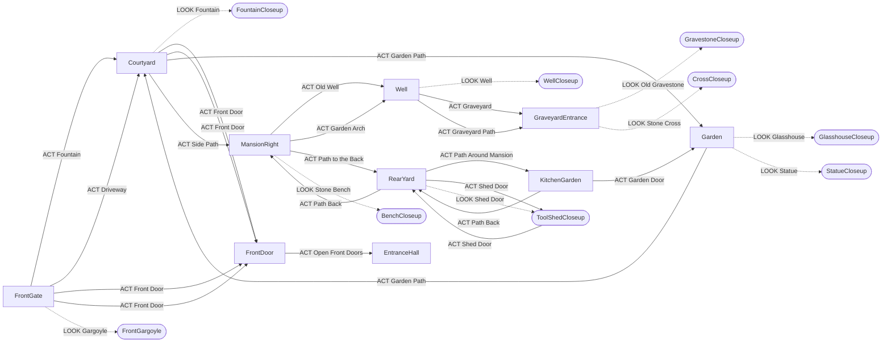

# The Mansion – Scenes and Close-ups

Generated from `Data/Scenes.cs` by `Tools/list_scenes.py` – re-run it after
changing scenes. **LOOK** opens close-ups, **ACT** moves on, the Return arrow
works with any verb.

## Map

Rounded boxes are close-ups. Dotted arrows = LOOK, solid = ACT.

## Contents

- [FrontGate](#frontgate) – Scene
- [FountainCloseup](#fountaincloseup) – Close-up
- [Courtyard](#courtyard) – Scene
- [Garden](#garden) – Scene
- [StatueCloseup](#statuecloseup) – Close-up
- [GlasshouseCloseup](#glasshousecloseup) – Close-up
- [MansionRight](#mansionright) – Scene
- [RearYard](#rearyard) – Scene
- [ToolShedCloseup](#toolshedcloseup) – Close-up
- [KitchenGarden](#kitchengarden) – Scene
- [BenchCloseup](#benchcloseup) – Close-up
- [Well](#well) – Scene
- [GraveyardEntrance](#graveyardentrance) – Scene
- [WellCloseup](#wellcloseup) – Close-up
- [CrossCloseup](#crosscloseup) – Close-up
- [GravestoneCloseup](#gravestonecloseup) – Close-up
- [FrontGargoyle](#frontgargoyle) – Close-up
- [FrontDoor](#frontdoor) – Scene
- [EntranceHall](#entrancehall) – Scene

## FrontGate

**Scene** · `Assets/Backgrounds/Mansion/frontgate.png`

> You are standing before an old and creepy mansion.

- **Picture changes** to `Assets/Backgrounds/Mansion/frontgate_open.png` when **FrontDoorOpen**
- **Reached from:** Courtyard – Return arrow; FrontGargoyle – Return arrow
- **Exits:** Courtyard (ACT *Fountain*); Courtyard (ACT *Driveway*); FrontDoor (ACT *Front Door*); FrontDoor (ACT *Front Door*)
- **Close-ups:** FrontGargoyle (LOOK *Gargoyle*)

| Object | LOOK | ACT | TALK | Items |
|---|---|---|---|---|
| Fountain | An ancient stone fountain stands in the courtyard beyond the gates. | → **Courtyard** | – | – |
| Driveway | Wet cobbles lead through the gates towards the mansion. | → **Courtyard** | – | – |
| Left Gate | A tall wrought-iron gate, standing open. | The gate is already open. It seems to prefer it that way. | – | – |
| Right Gate | A tall wrought-iron gate, standing open. | The gate is already open. It seems to prefer it that way. | – | – |
| Lantern (2 places) | A lantern burns on the gate pillar. Someone keeps these lit. | The glass is hot. Whoever lit it wants it to stay lit. | – | – |
| Coat of Arms | A weathered coat of arms is set into the pillar. The carving has worn too smooth to read. | – | – | – |
| Empty Pillar | The top of the right-hand gate pillar is empty. The moss up there has a gargoyle-shaped gap in it. | It's well out of reach. | (changes - see Data/Scenes.cs) | – |
| Front Door *(only when not FrontDoorOpen)* | The enormous wooden door looks like it has not opened in years. | → **FrontDoor** | – | – |
| Front Door *(only when FrontDoorOpen)* | The front doors stand open. Candlelight spills down the steps. | → **FrontDoor** | – | – |
| Gargoyle | → **FrontGargoyle** | – | – | – |

## FountainCloseup

**Close-up** · `Assets/Backgrounds/Mansion/fountain_closeup.png`

> Lily pads float on the dark water. Spouts of water splash down from the fountain above.

- **Picture changes** to `Assets/Backgrounds/Mansion/fountain_closeup_nocoins.png` when **StoleCoins**
- **Reached from:** Courtyard – LOOK on *Fountain*
- **Return arrow →** Courtyard
- **Characters:** King Hautain (ACT *Gold Coins*, conversation `HautainCoins`); King Hautain (ACT *Fountain Floor*, conversation `HautainCoins`)

| Object | LOOK | ACT | TALK | Items |
|---|---|---|---|---|
| Gold Coins *(only when not StoleCoins)* | Several old gold coins rest at the bottom of the fountain. | conversation `HautainCoins` | – | – |
| Fountain Floor *(only when StoleCoins)* | A cleaner patch on the fountain floor, where the coins used to lie. | conversation `HautainCoins` | – | **Gold Coins**: You drop the stolen coins back into the fountain. From somewhere among the lily pads comes a grudging "Hmph." (Royal Grudge lifted) (item used up) |
| Fountain | The fountain's carved stone base, green with moss. Above it, stone lions spit water into the basin. | – | The lions keep their mouths full. | – |
| Water Lily | A single pale water lily, open in the rain. | You leave it be. It's the only thing here that looks content. | – | – |

## Courtyard

**Scene** · `Assets/Backgrounds/Mansion/courtyard.png`

> Rain-slick cobblestones glitter in the lantern light. A tiered fountain splashes beside the steps up to the front door.

- **Picture changes** to `Assets/Backgrounds/Mansion/courtyard_open.png` when **FrontDoorOpen**
- **Reached from:** FrontGate – ACT on *Fountain*; FrontGate – ACT on *Driveway*; FountainCloseup – Return arrow; Garden – ACT on *Garden Path*; Garden – Return arrow; MansionRight – Return arrow; FrontDoor – Return arrow
- **Exits:** FrontDoor (ACT *Front Door*); FrontDoor (ACT *Front Door*); Garden (ACT *Garden Path*); MansionRight (ACT *Side Path*)
- **Close-ups:** FountainCloseup (LOOK *Fountain*)
- **Return arrow →** FrontGate

| Object | LOOK | ACT | TALK | Items |
|---|---|---|---|---|
| Fountain | → **FountainCloseup** | – | The fountain burbles. It is not a conversation. | – |
| Statue | A robed stone woman stands at the top of the fountain, hands folded, looking away from the house. | She's well out of reach, at the top of the fountain. | She keeps looking away. You get the feeling it's deliberate. | – |
| Front Door *(only when not FrontDoorOpen)* | Wide stone steps lead up to the mansion's great carved doors. | → **FrontDoor** | – | – |
| Front Door *(only when FrontDoorOpen)* | At the top of the steps the great doors stand open. Candlelight spills out into the rain. | → **FrontDoor** | – | – |
| Lantern (2 places) | An iron lantern beside the door. Someone keeps these lit. | Too high to reach from down here. | – | – |
| Urn (2 places) | A stone urn on the balustrade, overflowing with ivy and red flowers. | – | – | – |
| Windows (2 places) | Rows of tall Gothic windows, every one of them lit. Nobody appears in any of them. | The windows are well out of reach. | – | – |
| Lamp Post | A lamp post at the edge of the courtyard, lighting the way round the side of the house. | The glass is hot. Whoever lit it wants it to stay lit. | – | – |
| Garden Path | Past the fountain, a cobbled path winds away towards a hooded statue and a glowing glasshouse. | → **Garden** | – | – |
| Side Path | A wet cobbled path curves away round the right side of the mansion. | → **MansionRight** | – | – |

## Garden

**Scene** · `Assets/Backgrounds/Mansion/garden.png`

> The path ends in an overgrown garden. Mist curls around a hooded statue, and beyond it a great glasshouse glows in the dark.

- **Picture changes** to `Assets/Backgrounds/Mansion/garden_nosword.png` when **TookStoneSword**
- **Reached from:** Courtyard – ACT on *Garden Path*; StatueCloseup – Return arrow; GlasshouseCloseup – Return arrow; KitchenGarden – ACT on *Garden Door*
- **Exits:** Courtyard (ACT *Garden Path*)
- **Close-ups:** GlasshouseCloseup (LOOK *Glasshouse*); StatueCloseup (LOOK *Statue*)
- **Return arrow →** Courtyard

| Object | LOOK | ACT | TALK | Items |
|---|---|---|---|---|
| Glasshouse | → **GlasshouseCloseup** | It's a long way to walk just to push on glass. A closer look first. | – | – |
| Mansion | Ivy smothers the mansion's left wing. Warm light glows in the tall windows. | The windows are well out of reach. | – | – |
| Lantern | A lantern on a stone pillar lights the garden path. Someone keeps these lit. | The glass is hot. Whoever lit it wants it to stay lit. | – | – |
| Hydrangeas | Pink hydrangeas, heavy with rain, crowd the foot of the mansion wall. | – | – | – |
| Garden Path | The wet path winds back towards the courtyard. | → **Courtyard** | – | – |
| Statue | → **StatueCloseup** | – | The statue is too far away to hear you. Probably. | – |

## StatueCloseup

**Close-up** · `Assets/Backgrounds/Mansion/statue_closeup.png`

> The statue towers over you: a hooded figure in a ragged stone robe, its hands resting on the hilt of a great sword.

- **Picture changes** to `Assets/Backgrounds/Mansion/statue_closeup_nosword.png` when **TookStoneSword**
- **Reached from:** Garden – LOOK on *Statue*
- **Return arrow →** Garden

| Object | LOOK | ACT | TALK | Items |
|---|---|---|---|---|
| Glasshouse (2 places) | Through the mist, candles glow behind the glasshouse's tall panes. | – | – | – |
| Mansion | The mansion's ivy-covered wall rises beside the statue, every window lit. | The windows are well out of reach. | – | – |
| Statue | Ivy creeps up the ragged stone robe. Under the hood there is only darkness. | – | The statue says nothing. Statues usually don't. Usually. | – |
| Hood | You peer into the hood. There is no face carved there at all - just shadow. | You reach up into the hood. Stone, all the way back. | – | – |
| Stone Sword *(only when not TookStoneSword)* | A great stone sword, its point resting on the plinth. The hilt is worn smooth, as if many hands have gripped it. Words are cut along the blade: HE WHO WOULD TAKE THE BLADE MUST FIRST SURRENDER HIS OWN. | (depends on a dice roll / the story - see Data/Scenes.cs)  [gives Stone Sword]  [sets TookStoneSword] | – | – |
| Empty Hands *(only when TookStoneSword)* | The statue's stone hands are folded around nothing now. Under the hood, the darkness seems... satisfied. | – | – | – |

## GlasshouseCloseup

**Close-up** · `Assets/Backgrounds/Mansion/glasshouse_closeup.png`

> The glasshouse rises before you, all iron lace and misted glass. Inside, hundreds of candles burn among tall palms.

- **Reached from:** Garden – LOOK on *Glasshouse*
- **Return arrow →** Garden

| Object | LOOK | ACT | TALK | Items |
|---|---|---|---|---|
| Glass Dome | Rain beads on the great glass dome. Ivy has crept almost to the top. | – | – | – |
| Windows (2 places) | Through the misted panes you can make out palms, ferns - and candles, far too many candles. | The windows are well out of reach. | – | – |
| Lantern (2 places) | An iron lantern on a stone pillar, lighting the steps. | The glass is hot. Whoever lit it wants it to stay lit. | – | – |
| Chandelier | A chandelier blazes just inside, above the doors. Someone lit every candle. | It's on the other side of the glass. Which is probably for the best. | – | – |
| Glasshouse Doors | Tall glass doors with brass handles. The air seeping out is warm and smells of earth and wax. | You push the doors. They don't open - yet they rattle, as if something inside pushed back.  [sets TriedGlasshouseDoors] | You call through the glass. Nobody answers. The candles burn on regardless. | – |

## MansionRight

**Scene** · `Assets/Backgrounds/Mansion/mansion_right.png`

> A wet stone path runs along the Mansion's right wing, between candlelit windows and a wall of roses. Ahead, an archway opens onto steps climbing to an old well.

- **Picture changes** to `Assets/Backgrounds/Mansion/mansion_right_rose_cut.png` when **GotRedRose**
- **Reached from:** Courtyard – ACT on *Side Path*; RearYard – ACT on *Path Back*; RearYard – Return arrow; BenchCloseup – Return arrow; Well – Return arrow
- **Exits:** Well (ACT *Old Well*); Well (ACT *Garden Arch*); RearYard (ACT *Path to the Back*)
- **Close-ups:** BenchCloseup (LOOK *Stone Bench*)
- **Return arrow →** Courtyard

| Object | LOOK | ACT | TALK | Items |
|---|---|---|---|---|
| Windows (3 places) | Candles burn behind the tall windows, but nothing moves inside. | The windows are well out of reach. | – | – |
| Balustrade | A heavy stone balustrade runs along the foot of the wall, slick with rain. | – | – | – |
| Old Well | A small roofed well stands at the top of the hill. | → **Well** | You'd need to be a lot closer to talk down a well. | – |
| Garden Arch | An ivy-covered archway in the garden wall. Steps beyond it climb towards the well. | → **Well** | – | – |
| Path to the Back | Beside the lantern, the cobbles slip round the corner of the Mansion, towards the back of the house. | → **RearYard** | – | – |
| Lantern | A lantern burns on the garden wall. Its flame burns steadily, despite the rain. | The glass is hot. Whoever lit it wants it to stay lit. | – | – |
| Rose Bush *(only when not GotRedRose)* | A great tangle of blood-red roses, impossibly in bloom this late in the year. | (depends on a dice roll / the story - see Data/Scenes.cs) | You compliment the roses. The thorns remain unpersuaded. | **Garden Shears**: Snip. Much better. You cut one perfect dark-red rose. |
| Rose Bush *(only when GotRedRose)* | A great tangle of blood-red roses. There's a small gap where you cut one. | (depends on a dice roll / the story - see Data/Scenes.cs) | You compliment the roses. The thorns remain unpersuaded. | **Garden Shears**: You already have a rose. Leave the rest of them be. |
| Hydrangeas | Pale hydrangeas, heavy with rain. They have lost all their colour. | You leave them be. They look like they've had a difficult night. | – | – |
| Stone Bench *(only when not HeardBenchNoise)* | A mossy stone bench beside the roses. | You sit down on the cold, damp stone... and from somewhere underneath you comes a faint hiccup. Then a tiny, slurred giggle.  [sets HeardBenchNoise] | The bench says nothing. Benches rarely do. | – |
| Stone Bench *(only when HeardBenchNoise)* | → **BenchCloseup** | You sit down again. The hiccuping stops. Then: "...I can hear you breathing." | – | – |

## RearYard

**Scene** · `Assets/Backgrounds/Mansion/rear_yard.png`

> A rain-soaked service yard behind the Mansion. Ordinary work seems to have simply stopped here.

- **Reached from:** MansionRight – ACT on *Path to the Back*; ToolShedCloseup – ACT on *Shed Door*; ToolShedCloseup – Return arrow; KitchenGarden – ACT on *Path Back*; KitchenGarden – Return arrow
- **Exits:** MansionRight (ACT *Path Back*); KitchenGarden (ACT *Path Around Mansion*); ToolShedCloseup (ACT *Shed Door*)
- **Close-ups:** ToolShedCloseup (LOOK *Shed Door*)
- **Return arrow →** MansionRight

| Object | LOOK | ACT | TALK | Items |
|---|---|---|---|---|
| Path Back | The wet path continues around the side of the Mansion. | → **MansionRight** | – | – |
| Path Around Mansion | The narrow service path continues around the Mansion. Something glass-roofed is visible through the trees. | → **KitchenGarden** | – | – |
| Ivy | Ivy has claimed most of the rear wall. The Mansion rises almost vertically above the little service yard. | – | – | – |
| Windows (2 places) | Narrow service windows overlook the yard. A few glow warmly despite the abandoned courtyard below. | The windows are well out of reach. | – | – |
| Lantern | A lantern burns beside the service door. Someone keeps these lit. | The glass is hot. Whoever lit it wants it to stay lit. | – | – |
| Kitchen Door | A heavy service door leads into the Mansion, with a small barred window and heavy iron hardware. Generations of boots have worn the edges of the stone steps smooth. | The door shifts half an inch, then stops against something solid. Bolted from the other side.  [sets TriedKitchenDoor] | You call out. The bolt on the other side doesn't care who you are. | – |
| Cellar Doors *(only when not TriedCellarDoor)* | A pair of heavy cellar doors descend beneath the Mansion. The left door doesn't quite sit flush with its frame. | You pull the iron ring. The door rises an inch. Stops. Something underneath is holding it shut. ... A single quiet sound comes from underneath. Knock.  [sets TriedCellarDoor] | You lean close to the gap and say hello. The rain answers instead. | – |
| Cellar Doors *(only when TriedCellarDoor)* | A pair of heavy cellar doors descend beneath the Mansion. The left door doesn't quite sit flush with its frame. | Still blocked. Whatever is beneath it isn't moving. | You lean close to the gap and say hello. The rain answers instead. | – |
| Clothesline | An old washing line stretches across the yard. Almost everything that once hung from it is gone. | – | – | – |
| Sock | A solitary black sock hangs from the washing line. | (depends on a dice roll / the story - see Data/Scenes.cs)  [sets TouchedSock] | The Sock has nothing to say. | – |
| Hand Pump | An old iron hand pump feeds the stone washing trough. The metal is rusted, but the mechanism appears intact. | (depends on a dice roll / the story - see Data/Scenes.cs)  [sets TroughFilled] | – | – |
| Stone Trough *(only when not TroughFilled)* | A deep stone trough stained by generations of water. | Dry, apart from rain collecting in the bottom. | – | – |
| Stone Trough *(only when TroughFilled)* | Cold rainwater and pump water fill the old stone trough. | The water is painfully cold. | – | – |
| Drain | Rainwater disappears through an iron grate beneath the Mansion. A few tiny pale fragments have collected against the grate. Probably kitchen scraps. | The grate is firmly set into the cobbles. | Your voice drops down the drain and doesn't come back up. | – |
| Tool Shed | A small gardening shed leans against the wall, its roof thick with moss. The tools outside have been left exactly where someone last used them. Apparently nobody came back for them. | The door is the part that opens. | – | – |
| Shed Door | → **ToolShedCloseup** | → **ToolShedCloseup** | – | – |
| Rope *(only when not GotRope)* | A coil of old rope hangs on the shed wall. Damp, but stronger than it looks. | You lift the coil of rope off its hook.  [gives Rope]  [sets GotRope] | – | – |
| Shovel | A heavy garden shovel hangs from a hook rusted solid around its handle. | It isn't coming free without taking half the shed with it. | – | – |
| Pitchfork | An old pitchfork. Several tines have rusted away. | You'd rather not carry a pitchfork around. It invites questions. | – | – |
| Rake | A rake with half its teeth missing. | You leave the rake where it lies. Stepping on it later is a tradition you can do without. | – | – |

## ToolShedCloseup

**Close-up** · `Assets/Backgrounds/Mansion/tool_shed_closeup.png`

> The shed door scrapes open. Inside it smells of rust, damp wood and old soil. A lantern burns on the roof beam.

- **Picture changes** to `Assets/Backgrounds/Mansion/tool_shed_closeup_empty.png` when **GotGardenShears and GotCharcoal**
- **Picture changes** to `Assets/Backgrounds/Mansion/tool_shed_closeup_no_shears.png` when **GotGardenShears**
- **Picture changes** to `Assets/Backgrounds/Mansion/tool_shed_closeup_no_charcoal.png` when **GotCharcoal**
- **Reached from:** RearYard – ACT on *Shed Door*; RearYard – LOOK on *Shed Door*
- **Exits:** RearYard (ACT *Shed Door*)
- **Return arrow →** RearYard

| Object | LOOK | ACT | TALK | Items |
|---|---|---|---|---|
| Shelves | Rusted tins with no labels, and terracotta pots - stacked, tipped over, one of them broken. | You prise the lid off a tin. Rust, and the smell of old nails. You put the lid back. | – | – |
| Lantern | A small oil lantern hangs from the roof beam, lit. Someone keeps these lit. | The glass is hot. Whoever lit it wants it to stay lit. | – | – |
| Shed Door | The door hangs open behind you. Rain drips from its iron ring. | → **RearYard** | – | – |
| Cabinet | A tall, narrow cabinet, closed with a heavy iron padlock. Through the gaps in its boards you can see more rusted tins. | Locked, and not worth the trouble. It's only more tins. | – | – |
| Workbench | A scarred old workbench, worn smooth where hands rested on it for years. | You run a hand along the bench. Splinters, mostly. | – | – |
| Garden Shears *(only when not GotGardenShears)* | A sturdy pair of pruning shears - rusty, but still serviceable. | You take the garden shears.  [gives Garden Shears]  [sets GotGardenShears] | – | – |
| Charcoal *(only when not GotCharcoal)* | A few sticks of charcoal. Messy, but still usable. | You take the charcoal, and most of its dust with it.  [gives Charcoal]  [sets GotCharcoal] | – | – |
| Watering Can | An old galvanised watering can, dented and freckled with rust. | Empty. It's raining anyway. | – | – |
| Seed Crate | A wooden seed crate. | Empty, apart from a few dead leaves. | – | – |
| Flower Pots | More terracotta pots, stacked under the bench. | – | – | – |

## KitchenGarden

**Scene** · `Assets/Backgrounds/Mansion/kitchen_garden.png`

> A walled kitchen garden. The beds are still planted and weeded, as if the gardener only just stepped out. Beyond a door in the wall, the glasshouse glows.

- **Reached from:** RearYard – ACT on *Path Around Mansion*
- **Exits:** Garden (ACT *Garden Door*); RearYard (ACT *Path Back*)
- **Return arrow →** RearYard

| Object | LOOK | ACT | TALK | Items |
|---|---|---|---|---|
| Garden Wall | A high brick wall, thick with ivy. It keeps the wind out - and anything else. | – | – | – |
| Windows (2 places) | Candles burn in the Mansion's windows. Someone keeps a lot of candles. | The windows are well out of reach. | – | – |
| Rain Barrels | Two old rain barrels, full to the brim. | You peer into the barrel. Your reflection peers back. It takes a moment longer than it should. | – | – |
| Potting Bench | A potting bench with a few terracotta pots and a seed box. Everything has been put away neatly. | – | – | – |
| Hedge Clippers | A pair of hedge clippers, rusted completely shut. | They won't open. Whoever left them here hasn't been back for a very long time. | – | – |
| Bean Poles | Two wigwams of bean poles. Nothing grows on them now except a few dead tendrils. | – | – | – |
| Garden Door | An open door in the wall. Through it, the glasshouse glows in the mist. | → **Garden** | – | – |
| Vegetable Beds | Raised beds of cabbages and leeks, fat and healthy despite the season. Someone still tends them. | You pull at a leek. It doesn't budge. It feels... rooted rather more firmly than leeks ought to be. | – | – |
| Cabbage | An enormous purple cabbage. It is, objectively, a magnificent cabbage. | – | You compliment the cabbage. It accepts graciously. | – |
| Plant Label | A wooden plant label. Whatever was written on it has washed away. | – | – | – |
| Flower Pots | A few terracotta pots, one of them cracked and tipped on its side. | – | – | – |
| Path Back | The path leads back to the service yard. | → **RearYard** | – | – |

## BenchCloseup

**Close-up** · `Assets/Backgrounds/Mansion/bench_closeup.png`

> A carved stone bench stands against the wall, half swallowed by an enormous rose bush. Something tiny hiccups underneath it.

- **In the scene:** `Assets/Characters/Ebria_UnderBench.png`
- **Reached from:** MansionRight – LOOK on *Stone Bench*
- **Return arrow →** MansionRight
- **Characters:** Ebria (TALK *Ebria*, conversation `Ebria`)

| Object | LOOK | ACT | TALK | Items |
|---|---|---|---|---|
| Ferns | Ferns and lilies crowd the path, dripping with rain. | – | – | – |
| Stone Bench | The bench is carved with quatrefoils and scrolls. Rain has pooled in the seat. | You sit down. From underneath comes an indignant "Oi! Some of us live here!" | – | – |
| Rose Bush | The rose bush has grown right under the bench. Its thorns glint in the dark. | (depends on a dice roll / the story - see Data/Scenes.cs) | – | **Garden Shears**: Snip. Much better. You cut one perfect dark-red rose. **Garden Shears**: You already have a rose. Leave the rest of them be. |
| Ebria | A tiny fairy with wild red hair sits under the bench, swigging from a bottle labelled ANOTHER BAD IDEA. | – | conversation `Ebria` | – |

## Well

**Scene** · `Assets/Backgrounds/Mansion/well.png`

> An old stone well stands under a mossy roof. Beyond it, a path leads down to a fenced graveyard.

- **Reached from:** MansionRight – ACT on *Old Well*; MansionRight – ACT on *Garden Arch*; GraveyardEntrance – Return arrow; WellCloseup – Return arrow
- **Exits:** GraveyardEntrance (ACT *Graveyard*); GraveyardEntrance (ACT *Graveyard Path*)
- **Close-ups:** WellCloseup (LOOK *Well*)
- **Return arrow →** MansionRight

| Object | LOOK | ACT | TALK | Items |
|---|---|---|---|---|
| Well | → **WellCloseup** | – | "Hello?" ...Hello? ...hello? The echo takes rather too long to fade. | – |
| Bucket | A rusty bucket hangs from a chain over the well. It's empty. | You crank the bucket down into the dark. It comes back up empty - and somehow colder. | – | – |
| Lantern | A lantern hangs from the well's post, swinging gently in a wind you can't feel. | The glass is hot. Whoever lit it wants it to stay lit. | – | – |
| Graveyard | Gravestones crowd the hillside beyond the iron fence. | → **GraveyardEntrance** | – | – |
| Graveyard Path | A narrow path leads down past lit lanterns to the graveyard. | → **GraveyardEntrance** | – | – |

## GraveyardEntrance

**Scene** · `Assets/Backgrounds/Mansion/graveyard_entrance.png`

> The graveyard gates stand open. Mossy headstones lean beneath an ancient tree, and a stone cross rises over the hill.

- **Reached from:** Well – ACT on *Graveyard*; Well – ACT on *Graveyard Path*; CrossCloseup – Return arrow; GravestoneCloseup – Return arrow
- **Close-ups:** GravestoneCloseup (LOOK *Old Gravestone*); CrossCloseup (LOOK *Stone Cross*)
- **Return arrow →** Well

| Object | LOOK | ACT | TALK | Items |
|---|---|---|---|---|
| Old Tree | A huge, gnarled oak. Its roots have tipped several headstones over. | You'd rather not climb it in the rain. Or at all. | – | – |
| Lantern (2 places) | A lantern on the gatepost lights the way in. Someone keeps these burning. | The glass is hot. Whoever lit it wants it to stay lit. | – | – |
| Old Gravestone | → **GravestoneCloseup** | – | – | – |
| Stone Cross | → **CrossCloseup** | – | – | – |
| Graveyard Path | Mossy steps lead up between the graves, deeper into the graveyard. | – | – | – |

## WellCloseup

**Close-up** · `Assets/Backgrounds/Mansion/well_closeup.png`

> You peer down the well. Cobwebs stretch across the slick stones, and far below, something small glints in the dark.

- **Picture changes** to `Assets/Backgrounds/Mansion/well_closeup_empty.png` when **GotWellMirror**
- **Reached from:** Well – LOOK on *Well*
- **Return arrow →** Well

| Object | LOOK | ACT | TALK | Items |
|---|---|---|---|---|
| Well Shaft | The shaft drops away into darkness. The stones are wet and furred with cobwebs. | – | "Hello down there?" ...there. ...there. Something at the bottom seems to listen. | – |
| Bucket | The rusty bucket hangs from its chain at the edge of the well. | (depends on a dice roll / the story - see Data/Scenes.cs)  [gives Cracked Hand Mirror]  [sets GotWellMirror] | – | – |
| Something Glinting *(only when not GotWellMirror)* | At the very bottom of the well, something small and silver catches the light. | It's far too deep to reach. You'd need something long - or something to fish with. | – | **Ball of String**: You tie a loop in the end of the string and lower it down... after a few patient tries the loop catches a handle. You reel up a small silver hand mirror. The glass is cracked straight across. (gives Cracked Hand Mirror; sets GotWellMirror) |

## CrossCloseup

**Close-up** · `Assets/Backgrounds/Mansion/cross_closeup.png`

> The great stone cross looms over you, every inch of it carved with endless knots.

- **Picture changes** to `Assets/Backgrounds/Mansion/cross_closeup_open.png` when **CrossOpened**
- **Reached from:** GraveyardEntrance – LOOK on *Stone Cross*
- **Return arrow →** GraveyardEntrance

| Object | LOOK | ACT | TALK | Items |
|---|---|---|---|---|
| Moon | The full moon hangs over the graveyard. It looks closer than it should. | Out of reach. Comfortably. | The moon has heard it all before. | – |
| Celtic Cross | Knots weave in and out of each other without beginning or end. At the centre, three spirals chase one another: one reaching up, one to the left, one to the right. | – | You read the knots aloud, as if they were words. They are not. You feel slightly foolish. | – |
| Spirals | At the very centre of the cross, three stone spirals are set into the stone, each in its own round socket. | – | – | – |
| Plinth *(only when not CrossOpened)* | A mossy stepped plinth. A small knotwork panel is set into its face, as if something might be hidden behind it. | You press the carved panel. It doesn't budge - but the stone around it sounds hollow. | – | – |
| Open Plinth *(only when CrossOpened and not FoundPhotograph)* | The knotwork panel in the plinth has slid aside. Something lies in the hollow behind it. | Inside the hollow lies a tiny, old photograph. As your fingers close around it, the rain stops. Not slows. Stops. You remember sunlight. You don't remember remembering sunlight. Then the rain resumes. (Memento: Worn Photograph)  [gives Worn Photograph]  [sets FoundPhotograph] | – | – |
| Empty Plinth *(only when FoundPhotograph)* | The hollow in the plinth is empty now. | – | – | – |

## GravestoneCloseup

**Close-up** · `Assets/Backgrounds/Mansion/gravestone_closeup.png`

> An old headstone, smothered in ivy and lichen. Its inscription has almost worn away.

- **Reached from:** GraveyardEntrance – LOOK on *Old Gravestone*
- **Return arrow →** GraveyardEntrance

| Object | LOOK | ACT | TALK | Items |
|---|---|---|---|---|
| Moon | The full moon hangs low over the graveyard. | Out of reach. Comfortably. | The moon has heard it all before. | – |
| Gravestone | Ivy has crept up both sides of the stone, as if trying to hold it upright. | – | You speak to the stone. Whoever lies here stopped listening long ago. | – |
| Carved Cross | A small Celtic cross is carved at the top, the same knotwork as the great cross on the hill. | – | – | – |
| Inscription | Most of the inscription has been worn smooth. A few shallow marks remain, but not enough to read. | (depends on a dice roll / the story - see Data/Scenes.cs) | – | **Charcoal**: ReadGravestone **Charcoal**: ReadGravestone (sets ReadGravestone) **Charcoal**: Charcoal straight onto the stone would only add marks. You need something to take a rubbing on. **Paper**: ReadGravestone **Paper**: ReadGravestone (sets ReadGravestone) **Paper**: You press the paper against the stone. Without something to rub across it, it stays blank. |

## FrontGargoyle

**Close-up** · `Assets/Backgrounds/Mansion/FrontGargoyle.png`

> The sad gargoyle watches you carefully with its stone face.

- **Reached from:** FrontGate – LOOK on *Gargoyle*
- **Return arrow →** FrontGate
- **Characters:** Sad Gargoyle (TALK *Gargoyle*, conversation `SadGargoyle`)

| Object | LOOK | ACT | TALK | Items |
|---|---|---|---|---|
| Gargoyle | Its stone eyes seem to follow you. Perhaps it wants to talk. | – | conversation `SadGargoyle` | – |

## FrontDoor

**Scene** · `Assets/Backgrounds/Mansion/Front_door.png`

> The heavy front door towers over you. A grotesque metal knocker hangs at its centre.

- **Picture changes** to `Assets/Backgrounds/Mansion/Front_door_open.png` when **FrontDoorOpen**
- **Reached from:** FrontGate – ACT on *Front Door*; FrontGate – ACT on *Front Door*; Courtyard – ACT on *Front Door*; Courtyard – ACT on *Front Door*; EntranceHall – Return arrow
- **Exits:** EntranceHall (ACT *Open Front Doors*)
- **Return arrow →** Courtyard
- **Characters:** Quazimodo (ACT *Front Doors*, conversation `QuazimodoFrontDoor`)

| Object | LOOK | ACT | TALK | Items |
|---|---|---|---|---|
| Front Doors *(only when not FrontDoorOpen)* | Heavy carved wooden doors under a pointed arch, with a window of stone tracery above. They appear to be locked. | conversation `QuazimodoFrontDoor` | The door does not answer. This is unsurprising. | – |
| Open Front Doors *(only when FrontDoorOpen)* | The front doors stand open. Beyond them, candlelight, a chequered floor and a grand staircase. | → **EntranceHall** | – | – |
| Door Knocker *(only when not FrontDoorOpen)* (2 places) | A grotesque iron knocker: a snarling face with a heavy ring through its jaws. It is freezing cold. | You rap the iron knocker against the door. The sound echoes somewhere deep inside the Mansion. | – | **Gold Coins**: You rap the knocker with a gold coin. Nothing. Manners, not money, the gargoyle said. **Royal Gold Coin**: You rap the knocker with the King's coin. Nothing. Manners, not money, the gargoyle said. |
| Window | Stone tracery above the doors, glowing with candlelight from inside. | Far out of reach. | – | – |
| Lantern (2 places) | An iron lantern beside the door. Someone keeps these lit. | The glass is hot. Whoever lit it wants it to stay lit. | – | – |
| Urn (2 places) | A stone urn overflowing with ivy and small red flowers, wet with rain. | You'd rather not dig through someone's flowerpot. | – | – |

## EntranceHall

**Scene** · `Assets/Backgrounds/Mansion/entrance_hall.png`

> The great hall of the Mansion. Every candle is lit, and the house is very quiet. The rain sounds far away now.

- **Reached from:** FrontDoor – ACT on *Open Front Doors*
- **Return arrow →** FrontDoor

| Object | LOOK | ACT | TALK | Items |
|---|---|---|---|---|
| Staircase | A grand staircase, carpeted in faded red, climbs to a landing and turns up into the dark. | You put a hand on the banister and look up into the dark. Not yet. | – | – |
| Landing | The stairs turn at a landing and climb on along the right-hand wall, into shadow. | You put a hand on the banister and look up into the dark. Not yet. | – | – |
| Window | A tall window above the stairs, framed by heavy red curtains. Rain streams down the glass. | The window is far above the stairs, and it doesn't look as if it opens. | – | – |
| Chandelier | A great brass chandelier, every candle lit. Fine silver threads are strung between its arms, glinting. | Far out of reach. | – | – |
| Family Portrait | A family portrait in a heavy gilt frame: five people in their best clothes. Where one face should be, the paint has flaked away to bare canvas. | The frame is fixed firmly to the wall. | Nobody in the portrait answers. One of them couldn't if they wanted to. | **Worn Photograph**: You hold the photograph up beside the portrait. Your eyes keep going to the same place in both: the face that isn't there. |
| Left Door | A tall panelled door on the left side of the hall. | The handle turns, but the door doesn't open. Not yet. | – | – |
| Right Door | A tall panelled door on the right side of the hall. | The handle turns, but the door doesn't open. Not yet. | – | – |
| Low Door | A small, low door, tucked in under the stairs. | It doesn't open. | – | – |
| Grandfather Clock | A tall grandfather clock. Its hands have stopped at a quarter past something. | You nudge the pendulum. It swings once, then stops again. | The clock has nothing to say. It has stopped saying anything at all. | – |
| Covered Mirror | A tall mirror, covered completely by a grey dust sheet. | You take hold of a corner of the sheet... and decide to leave it where it is. | – | – |
| Candles | Candles burn in a brass sconce. Someone keeps these lit. | The brass is hot. Whoever lit them wants them to stay lit. | – | – |
| Candles | Candles burn in a brass sconce on the landing. Someone keeps these lit. | Out of reach from down here. | – | – |
| Coat Stand | A crooked coat stand. An old coat hangs from it, still damp. | You leave the coat where it is. It isn't yours. | "Good evening, Quazimodo." It is a coat stand. | – |
| Cat | A black cat sits on the stairs, watching you with unblinking yellow eyes. | You reach towards the cat. It shifts exactly far enough to stay out of reach. | You say hello. The cat considers this, and looks away. | – |
